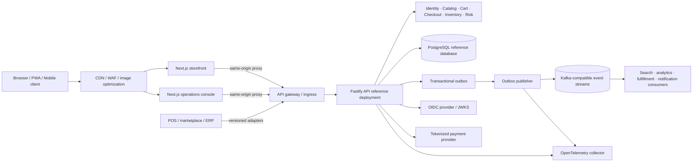

# Atlas Commerce Architecture

## Design principles

- **MACH:** API-first, headless web clients, cloud-native containers, and independently deployable domain boundaries.
- **Reference implementation:** the API currently hosts several domains together. Domain packages and service health scaffolds demonstrate seams, not complete production microservices.
- **Trust by boundary:** authenticate and authorize at the API; derive tenant identity from verified claims/host mapping, not untrusted request fields.
- **Events for integration:** commit domain state and outbox event atomically; deliver at least once and deduplicate by event ID.
- **Data minimization:** no raw card data, only coarse recommendation context with explicit consent, and no shared caching of personalized data.

## System context



The gateway, database, broker, identity provider, PSP, search engine, and observability backends are production infrastructure dependencies, not all included as runnable containers here.

The shopper account stores a supported locale, timezone and currency, and uses those settings for order date/money formatting. Most UI copy is currently English; production localization requires translation catalogs and review of regional legal, tax, shipping and number/date formats.

## Domain ownership

| Domain             | Reference responsibility                                  | Production data ownership / integration                                    |
| ------------------ | --------------------------------------------------------- | -------------------------------------------------------------------------- |
| Identity/profile   | Session verification, account preferences, consent, roles | OIDC identity provider plus profile service/database                       |
| Catalog            | Product records, categories, activation                   | Catalog service and read-optimized projection                              |
| Search             | Current reference SQL search                              | Dedicated search index fed by catalog events                               |
| Pricing/promotions | Fixed demo currency conversion; price fields              | Pricing engine and promotion rule service                                  |
| Cart               | Tenant-scoped cart and lines                              | Cart service/store with TTL and durable recovery policy                    |
| Checkout/orders    | Idempotent checkout and order lifecycle                   | Order service; durable workflow orchestration for long-running actions     |
| Inventory          | Available/reserved stock and checkout updates             | Inventory service with reservation expiry/reconciliation                   |
| Payments           | Mock adapter only                                         | PSP tokenization, signed webhooks, idempotent capture/refund               |
| Fulfillment        | Operator-driven demo status                               | OMS/WMS/carrier adapters and fulfillment service                           |
| Customer service   | Order context and review workflows                        | Support system adapter with least-privilege access                         |
| Notifications      | Event consumer boundary                                   | Email/SMS/push providers with delivery policy and consent                  |
| Recommendations    | Consent-gated category candidate ranking                  | Feature pipeline, online/offline stores, model registry and explainability |
| Fraud/risk         | Transparent demo rules and review queue                   | PSP signals, velocity store, calibrated models, analyst workflow           |
| Analytics/events   | Consent-aware event intake and outbox                     | Governed event taxonomy, streaming lake/warehouse and retention controls   |

The separate `services/` packages have liveness/readiness only. They are intentionally not represented as fully implemented production services.

## Checkout sequence

```mermaid
sequenceDiagram
  actor Shopper
  participant UI as Storefront
  participant Proxy as Same-origin proxy
  participant API as Checkout API
  participant DB as PostgreSQL
  participant Risk as Risk adapter
  participant PSP as Payment adapter
  participant Outbox as Outbox publisher
  participant Fulfillment as Fulfillment consumer

  Shopper->>UI: Submit checkout
  UI->>Proxy: POST /v1/checkout + Idempotency-Key
  Proxy->>API: Forward cookie and validated same-origin mutation
  API->>DB: Begin transaction; lock idempotency key, cart and stock
  API->>API: Recalculate prices, shipping and totals server-side
  API->>Risk: Score deterministic signals
  alt Demo adapter and non-production
    API->>PSP: Mock payment authorization
  else Production
    API-->>UI: 503 payment_provider_unavailable until real PSP adapter exists
  end
  API->>DB: Persist order, inventory update, audit and outbox atomically
  DB-->>API: Commit and idempotent response
  API-->>UI: Order confirmation
  Outbox->>Fulfillment: Publish order event at least once
  Fulfillment->>DB: Consumer deduplicates by event ID and advances workflow
```

The mock payment branch is explicitly disabled in production. A real PSP flow must keep network calls out of long-lived database transactions and use authorization/capture state transitions plus signed webhooks.

## Recommendation flow

```mermaid
sequenceDiagram
  actor Shopper
  participant UI as Storefront
  participant API as Recommendation API
  participant Consent as Profile consent
  participant Profile as Coarse preference
  participant Catalog as Catalog/inventory projection
  participant Ranker as Candidate ranker
  participant Events as Event outbox

  Shopper->>UI: Open home or product page
  UI->>API: GET /v1/recommendations
  API->>Consent: Read current recommendation consent
  alt Consent enabled
    API->>Profile: Read one recent category (if present)
  else No consent
    API->>Catalog: Request popular/featured candidates only
  end
  API->>Catalog: Fetch active, in-stock candidate products
  API->>Ranker: Rank by current product/category and simple features
  Ranker-->>API: Items with reason labels and cold-start fallback
  opt Analytics consent enabled
    API->>Events: Append recommendations.served event
  end
  API-->>UI: Explainable list; no sensitive profile attributes
```

The reference ranker is a deterministic rules-based abstraction. Production candidate generation and ranking need offline evaluation, consent propagation, feature governance, model monitoring, and deletion/retention workflows.

## Edge and cache boundaries

- Cache versioned static assets and product imagery at the CDN with immutable URLs and image resizing/format negotiation.
- Public catalog/search can use short TTL plus `stale-while-revalidate` if tenant/currency are explicit cache-key dimensions and invalidation is event-driven.
- Never publicly cache session, account, cart, checkout, order, admin, consent, or personalized recommendation responses.
- Keep edge personalization to non-sensitive, consent-aware coarse context; do not place identity or sensitive profile data in edge caches/logs.
- The service worker caches static assets only; it must never cache API or personalized responses.

## Production topology

Begin with the working modular API, not premature network fan-out. For independently owned services, use separate deployment, schema, database credentials, SLOs, queues and scaling policies per domain. Publish contract-versioned events through Kafka-compatible topics, e.g. `catalog.product.v1`, `inventory.stock.v1`, `order.placed.v1`, and `payment.status.v1`. Use outbox relays, schema registry compatibility checks, consumer groups, bounded retries, DLQs, replay tooling and idempotent consumers.

See [`database.md`](./database.md), [`operations.md`](./operations.md), and [`security.md`](./security.md) for persistence, reliability, and trust-boundary details.
