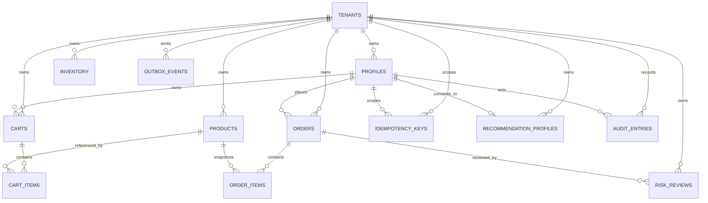

# Database and Data Ownership

## Reference schema

The current PostgreSQL schema is in `services/api/src/db/schema.ts`; immutable migration steps are in `services/api/drizzle/`. The demo schema is tenant-keyed and intentionally consolidated to make local setup practical.

## Tables and invariants

| Table                     | Responsibility                                              | Important constraints/indexes                                              |
| ------------------------- | ----------------------------------------------------------- | -------------------------------------------------------------------------- |
| `tenants`                 | Tenant root                                                 | Stable tenant identifier                                                   |
| `profiles`                | Account preferences, role, consent and OIDC subject mapping | Tenant + auth subject uniqueness; supported role/currency checks           |
| `products`                | Product identity, price, category, image and activation     | Tenant-scoped slug uniqueness; category/currency checks                    |
| `inventory`               | On-hand and reserved quantities                             | Tenant + product uniqueness; non-negative/reservation invariants           |
| `carts`, `cart_items`     | Shopper cart state                                          | Tenant/user unique cart; cart/product unique line                          |
| `orders`, `order_items`   | Immutable order totals and product snapshots                | Tenant/order number; status and totals; item snapshot rows                 |
| `idempotency_keys`        | Checkout request hash and replay response                   | Tenant/user/key uniqueness; expiration and request-hash conflict detection |
| `risk_reviews`            | Manual-review status and decision                           | Tenant/order association and status index                                  |
| `recommendation_profiles` | One coarse preferred category                               | Tenant/user uniqueness; constrained category                               |
| `outbox_events`           | Atomic domain events, retry/lease/dead-letter state         | Delivery index over publish, retry and lease fields                        |
| `audit_entries`           | Actor/action/target metadata for sensitive changes          | Tenant/time and target indexes                                             |

Column definitions and index details are authoritative in the schema and migration files; this summary is explanatory, not a replacement for them.

## Production split plan

When domain teams or load evidence justify service ownership, move to service-owned databases and credentials:

1. **Identity/profile:** identity subjects, preferences, consent, and authorization attributes. Keep credentials with the OIDC provider.
2. **Catalog/pricing:** canonical products, price lists, promotions, and immutable publication versions.
3. **Inventory:** authoritative stock, reservation ledger, expiry and reconciliation.
4. **Cart:** low-latency cart state, with explicit persistence/expiry and cross-device behavior.
5. **Orders/checkout:** order state machine, snapshots, idempotency records, audit and outbox.
6. **Risk/support:** segregated review data with strict operator roles and retention.
7. **Analytics:** event stream and warehouse separated from operational PII stores.

Use events and read models for cross-domain views; do not retain cross-service foreign keys or allow services to query another service's private database. Use dual-read/compare or outbox-fed projections during migrations, then cut over with reconciliation and rollback criteria.

## Migration practice

- Apply forward-only expand/contract migrations through a dedicated release job before new application pods roll out.
- Add nullable columns/tables and compatible indexes first; deploy code that tolerates old/new shape; backfill in bounded batches; enforce constraints only after verifying data.
- Avoid destructive renames/drops in the same release as code that stops using the old field.
- Maintain a tested restore path; schema rollback is not assumed to be safe.
- Keep seed fixtures synthetic and out of production databases.
